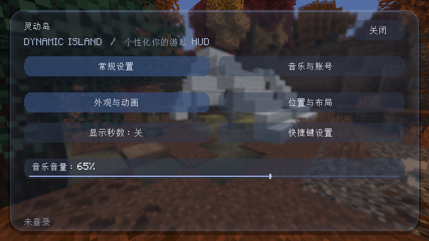
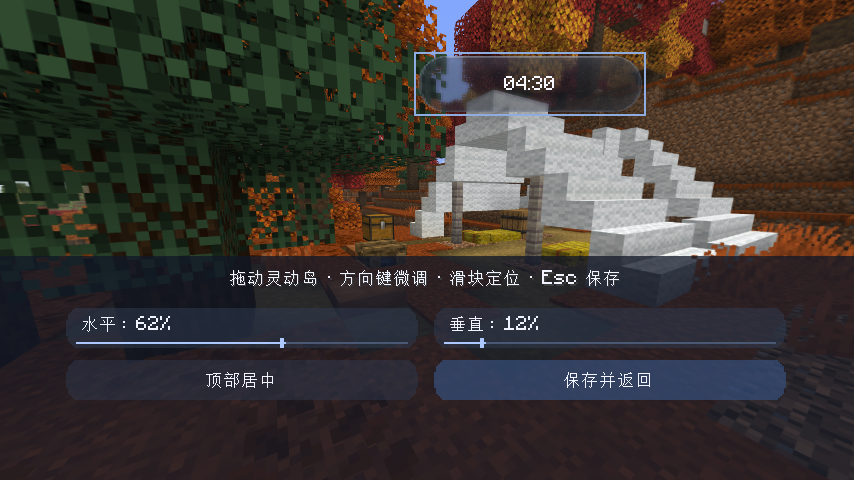

# 灵动岛 · Dynamic Island

为 Minecraft Fabric 添加一个灵动岛风格的 HUD，将本地时间、战斗目标生命值和网易云音乐播放信息放在屏幕上的圆角胶囊中。

[下载版本](https://github.com/tourio114/psychic-enigma/releases) · [更新日志](CHANGELOG.md) · [反馈问题](https://github.com/tourio114/psychic-enigma/issues) · [MIT 许可证](LICENSE)

> **v0.3.0 为开发预览版。** 已通过构建与自动化检查，并在测试客户端的软件 Vulkan 环境验证新版界面、拖动、方向键微调和重启后的坐标保存；战斗血量同步、网易云登录播放及不同硬件兼容性仍待验证。

## 界面预览

以下为测试客户端的实际截图（软件 Vulkan 渲染）。





## 运行要求

| 组件 | 版本 |
| --- | --- |
| Minecraft Java 版 | 26.3 |
| Fabric Loader | 0.19.5 或更高 |
| Fabric API | 与 Minecraft 26.3 对应的版本 |
| Java | 25 或更高 |

## 安装

1. 安装 Minecraft 26.3 的 Fabric Loader。
2. 下载 [v0.3.0 安装 JAR](https://github.com/tourio114/psychic-enigma/raw/refs/heads/main/releases/dynamic-island-0.3.0.jar)，或在 [Actions](https://github.com/tourio114/psychic-enigma/actions) 最新成功任务的 Artifacts 中下载。历史版本见 Releases。
3. 将模组 JAR 和对应版本的 Fabric API 放入游戏目录的 `mods` 文件夹。
4. 启动游戏，按 **右 Shift** 打开设置，支持标题界面或进入世界后打开。

不要将源码 ZIP、`-sources.jar` 或第三方库源码包放进 `mods`。

## 功能与操作

| 功能 | 说明 |
| --- | --- |
| 时钟 | 默认显示电脑本地时间，可切换是否显示秒数 |
| 灵动岛动画 | 阻尼弹簧展开与收起、文字淡入滑动、HUD 出现动画 |
| 液态玻璃 | 局部模糊、边缘折射、轻微色散、Fresnel 高光与亮度自适应着色 |
| 外观设置 | 背景不透明度 0–100%，玻璃质感和动画可独立开关，支持实时预览 |
| 受击反馈 | 攻击时高光脉冲，血条平滑过渡 |
| 自定义位置 | 选择“位置与布局”，拖动灵动岛；也可用滑块定位或方向键微调 |
| 可修改快捷键 | 默认右 Shift；点击“快捷键设置”进入原生按键设置 |
| 战斗面板 | 显示最近攻击目标的名称、生命值和血条，约 5 秒后收起 |
| 网易云音乐 | 搜索歌曲、点击播放、暂停/继续、停止、调整音量 |
| 登录 | 网易云 App 扫码确认，保存凭证；支持退出并清除本地凭证 |

### 外观与动画

右 Shift → **外观与动画**：拖动“不透明度”滑块可实时查看效果，点击“保存并返回”保存。默认背景不透明度为 62%；0% 隐藏底板，文字仍保持清晰。玻璃质感和动画可分别关闭，“恢复默认外观”可重置这三项设置。

玻璃材质移植自 [Jacquesqwq/LiquidGlassShader](https://github.com/Jacquesqwq/LiquidGlassShader) 实际公开的 V2 Tinted 片元着色器。保留原作者 MIT 版权声明，将其折射、色散、亮度自适应着色和 Fresnel 处理接入 Minecraft 26.3 RenderPearl，并在灵动岛与设置卡片区域内采样独立场景纹理，提供局部模糊。不会对整个世界执行模糊处理。渲染管线不可用时保留兼容的半透明外观。动画关闭后，面板、文字和血条立即切换，音乐柱保持静止。

### 联机生命值

准确生命值需要服务端同步。单人游戏使用内置服务器；多人游戏需要服务器也安装本模组和 Fabric API。

如果只有客户端安装，时钟与音乐仍可使用，战斗面板会显示“血量未同步”。

## 网易云音乐配置

音乐功能依赖单独部署的 [TH911/NeteaseCloudMusicApi](https://github.com/TH911/NeteaseCloudMusicApi)。模组内不包含 API 服务，GitHub 仓库地址也不能直接作为 API 地址。

按上游说明部署服务后：

1. 右 Shift 打开设置，进入“音乐与账号”，填写 API 地址并点击“保存接口”。本机部署默认可用 `http://localhost:3000`，远端部署填写实际的 HTTPS 服务地址。
2. 点击“扫码登录”，使用网易云音乐手机 App 扫码并确认。
3. 进入“音乐与账号”，输入关键词搜索，点击歌曲播放。
4. 登录失效后重新扫码；点击“退出账号”可删除本地凭证并停止播放。

`localhost` 指运行 Minecraft 的电脑。二维码等待上限为 150 秒，可点击关闭或按 Esc 取消。

**VIP 歌曲需要登录账号具备相应权限。** 登录不会绕过 VIP、版权或地区限制。接口只返回试听地址时会提示确认权限；当前播放器仅支持 MP3。音乐音量由模组内按钮控制，不跟随游戏的音乐音量设置。

### 配置文件

| 文件 | 内容 |
| --- | --- |
| `config/dynamicisland.json` | 位置、时间显示、API 地址、音量、不透明度、玻璃与动画开关 |
| `config/dynamicisland.session` | 与 API 地址绑定的网易云登录凭证 |

登录凭证以本地明文保存，不要上传或分享该文件。请使用自己信任的 API 服务；更换 API 地址不会将旧地址的凭证发送到新地址。退出仅清除本模组的本地登录状态。

## 从源码构建

需要 JDK 25+、Python 3，以及可访问 Gradle、Fabric Maven、Maven Central 和 Mojang 下载服务的网络。

Windows：双击 `build.bat`，或执行：

```powershell
py -3 tools/build.py
```

Linux / macOS：

```sh
./build.sh
```

脚本会下载 Gradle 9.6.0 并核对官方 SHA-256，再运行构建。已安装对应 Gradle 时也可执行 `gradle build`。Loom 固定为 1.17.21。

安装包输出位置：`build/libs/dynamic-island-0.3.0.jar`。

仓库包含 [GitHub Actions 工作流](.github/workflows/build.yml)，可手动构建或在源码变更后自动构建，成功后从对应任务的 Artifacts 下载。仓库的 `releases/` 目录也保留构建文件与 SHA-256 校验值。

## 测试状态与反馈

已通过 Java 编译、GitHub Actions 构建，以及动画自动化检查（不同帧率、尺寸边界、文字切换、血条、受击反馈和关闭动画），以及包内入口、元数据、语言资源和嵌入依赖检查。**构建成功不代表已通过游戏测试。**

测试客户端已验证：设置页打开、原生左键拖动、方向键微调、位置保存及重启后恢复。GLSL 已通过离屏 OpenGL 编译与渲染检查。

仍待验证：不同硬件及资源包下的渲染兼容性、改键、单人及联机血量同步、扫码登录、VIP 权限、音频设备与异常网络下的播放行为。

反馈问题时请附上游戏版本、Fabric Loader / Fabric API 版本、复现步骤与相关日志。提交前请移除登录 cookie 等敏感信息。

## 开源协议与来源标注

本项目原创代码采用 [MIT License](LICENSE)，版权声明为 **tourio114**，项目来源为：

https://github.com/tourio114/psychic-enigma

允许商业使用、修改、分发和销售，也允许用于闭源项目。分发本软件的副本或实质性部分时，必须保留 `LICENSE` 中的版权声明和许可声明；版权声明已包含原项目地址。

建议在衍生项目 README 或“关于”页面注明：

> 基于 tourio114 的 Dynamic Island 项目：https://github.com/tourio114/psychic-enigma（MIT License）。

上述示例是推荐的展示方式；MIT 的正式要求以 `LICENSE` 原文为准，不额外强制界面署名。第三方库保留各自许可证，详见 [THIRD_PARTY_NOTICES.md](THIRD_PARTY_NOTICES.md) 和 [licenses/](licenses/)。MIT 不授予网易云音乐内容、Minecraft 素材或其他第三方内容的使用权。

## 致谢

- [Fabric](https://fabricmc.net/)：模组加载器与开发 API。
- [TH911/NeteaseCloudMusicApi](https://github.com/TH911/NeteaseCloudMusicApi)：网易云音乐服务接口。
- [JLayer](https://www.javazoom.net/javalayer/javalayer.html)：MP3 解码。
- [ZXing](https://github.com/zxing/zxing)：登录二维码生成。
- [Jacquesqwq/LiquidGlassShader](https://github.com/Jacquesqwq/LiquidGlassShader)：移植的液态玻璃光学算法（MIT，Copyright 2026 Jack）。

### 着色器开发检查

`verifyAnimation` 随 Gradle check 执行，覆盖动画和缩放坐标定位。可选的 `tools/verify_glass.py` 使用 ModernGL、Pillow 和 EGL，离屏编译并渲染实际 GLSL，检查圆角、透明度、区域外不受影响和模糊降噪。可在具备 EGL 的 Linux 开发环境运行 `uv run --with moderngl --with pillow tools/verify_glass.py`。这不等同于完整的游戏兼容性测试。
